# VetoBoard MCP (`vetoboard-mcp`)

<p align="center">
  
  
  
  
</p>

<p align="center">
  <b>Reduce single-model sycophancy, multi-agent mesh brawls, and mental-math hallucinations inside your AI coding IDE.</b><br/>
  Dynamic Shared Whiteboard, ELECTRE/QMV Mathematical Dominance Voting, 16 Bilingual Specialist Roles, 27 Pure-Text Governance Skills &amp; Deterministic Math Reconciliation (`vetoboard_calc`).
</p>

<p align="center">
  <a href="./README.md">简体中文</a> | <b><a href="./README.en.md">English</a></b>
</p>

> [!TIP]
> **Design Philosophy & Smart Model Sizing (Read First)**:
> - **Trading Time & Structured Tokens for High-Reliability Accuracy**: Through concurrent live web grounding, shared whiteboard cross-examination, `ELECTRE/QMV` mathematical dominance voting, and `vetoboard_calc` 0.5%-tolerance arithmetic verification, VetoBoard trades execution time and multi-round tokens to reduce single-model sycophancy and mental-math hallucinations for higher-reliability decisions.
> - **Running Frontier Models on Every Seat Is Pure Waste — Use `Flash` Tiers!**: Because structural cross-checking and deterministic math gates handle error correction, **stacking expensive flagship models (e.g., all-Opus / all-GPT-5) across every specialist role wastes both quota and latency**. We strongly recommend fast, cost-effective models such as **`Gemini Flash`**, **`DeepSeek-V3`**, or **`Claude Haiku / Sonnet`** for specialist seats (optionally pairing 1 cross-family model on the final read-only Inspector), saving **70%–85%** of tokens with zero loss in audit rigor.

---

## 📦 1. Installation

### ⭐ Option 1: Paste One Prompt into Your AI Agent (Zero Manual Terminal Work)
Simply paste the prompt below directly into **Antigravity, Claude Code, Cursor, Codex, Hermes, or T3 Code** and let your agent install it for you:

```text
Please install https://github.com/sanzi8/vetoboard-mcp for me: download vetoboard-mcp-v1.4.1.zip from the latest GitHub Release, extract it to ~/.vetoboard-mcp/runtime, and run `node ./dist/cli.js init --local-bin`.
```

Then click **`MCP Servers > Refresh`** in your IDE (or toggle `vetoboard-mcp` ON in Antigravity `Customizations`)!

### Option 2: Download Pre-Built Release Bundle Manually
1. Visit **[Releases](https://github.com/sanzi8/vetoboard-mcp/releases/latest)**, download `vetoboard-mcp-v1.4.1.zip`, and extract it to a permanent folder.
2. Run the 1-command installer inside the extracted folder:
   ```bash
   node ./dist/cli.js init --local-bin
   ```
3. The installer automatically detects **Antigravity, Claude Code, Cursor, OpenAI Codex, Hermes Agent, and OpenCode / T3 Code**, non-destructively installing the MCP server, guardrail rules, `/vetoboard` command, **16 bilingual specialist roles**, and **27 pure-text governance skills**.

### Option 3: Clone & Build from Source
```bash
git clone https://github.com/sanzi8/vetoboard-mcp.git
cd vetoboard-mcp
pnpm install && pnpm run build
node ./dist/cli.js init --local-bin
```

---

## 🚀 2. Step-by-Step Usage Guide

> [!IMPORTANT]
> **Zero Extra API Cost by Default**: `vetoboard-mcp` defaults to `host-subscription` mode — reusing your existing IDE subscription with **\$0 extra third-party API cost**. Pre-flight model selection and role weight tuning happen right in normal chat prose with zero popups.



1. **Step 1 — Launch Pre-Flight Bench**: Type `/vetoboard <your business plan or software architecture goal>`. VetoBoard scans your reusable roles, skills, and historical Knowledge Cards, groups your host models & quotas, and prints a 6-column recommended lineup table.
2. **Step 2 — Confirm or Customize in Plain Language**: Reply **`Go`** (or e.g. *`"Use opus for profit-modeler, flash for tech-feasibility, add hr-roi-analyst, Go"`*). Specialists run live web grounding (`board_post`), adjudicate conflicts via **ELECTRE + EU QMV** (`board_review`, `D >= 60%/65%`, `C >= 66.7%`, `R <= 2` early stop), write parallel deliverables, and pass a cross-family **`[V1]` Quality Inspector** (`vetoboard_calc` 0.5% tolerance audit).
3. **Step 3 — Read Cited Bundle & Distill Assets**: Inspect the 3 exported workspace `.md` reports (`-briefing.md` with clickable `[[S1·§2]]` & `[[V1]]` anchors, `-report.md`, `-original-report.md`), and optionally reply *`"Save as skill"`* or *`"Save as project pack"`*.

---

## 🧩 3. Included MCP Tools (13 Tools) & Built-in Arsenal

- **13 Governance Tools**: `vetoboard_plan_lineup`, `vetoboard_start_council`, `vetoboard_update_council`, `vetoboard_submit_track_output`, `vetoboard_calc`, `vetoboard_audit_output`, `vetoboard_distill_skill`, `vetoboard_contribute_asset`, `vetoboard_self_update`, `vetoboard_clarify_routes`, `vetoboard_get_role_charter`, `vetoboard_compress_memorial`, `vetoboard_task_status`.
- **16 Built-in Specialist Roles**: `market-analyst`, `profit-modeler`, `legal-advisor`, `tech-feasibility`, `operations-sop`, `risk-assessor`, `product-strategist`, `hr-roi-analyst`, `plg-growth-strategist`, `saas-billing-architect`, `task-delegation-advisor`, `software-architect`, `backend-engineer`, `frontend-engineer`, `code-reviewer`, and `quality-inspector`.
- **27 Pure-Text Governance Skills**: Bundled in [`./skills/`](./skills) with original upstream `MIT` / `Apache-2.0` licenses preserved.

---

## 🛠️ Development & Verification

```bash
pnpm install
pnpm run build
pnpm test
pnpm run smoke:llm
```

---

## 📄 License

Licensed under the [Apache License 2.0](./LICENSE).
