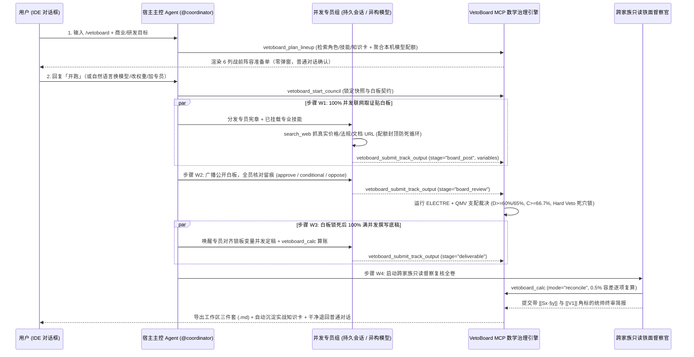

# VetoBoard MCP (`vetoboard-mcp`)

<p align="center">
  
  
  
  
</p>

<p align="center">
  <b>终结单模型对话中的「顺从迎合」、「多智能体拉群混战」与「心算幻觉」——将动态共享白板、ELECTRE/QMV 运筹学数学裁决、16 大专业角色、27 个治理技能包与 0.5% 容差独立核账器一键接入你的 AI 编程工具。</b><br/>
  Dynamic Shared Whiteboard, ELECTRE/QMV Mathematical Dominance Voting, Non-Compensatory Hard Veto &amp; Zero-Hallucination Math Auditing MCP Server.
</p>

<p align="center">
  <b><a href="./README.md">简体中文</a></b> | <a href="./README.en.md">English</a>
</p>

> [!TIP]
> **核心机制与模型省配铁律（必看）**：
> - **用时间与结构化 Token 换取推理准确性**：VetoBoard 的本质是通过「多角色并发联网取证 + 共享白板交叉质询 + `ELECTRE/QMV` 数学支配裁决 + `vetoboard_calc` 0.5% 容差独立复算」，以一定的执行时间与多轮 Token 消耗为代价，彻底消灭单模型顺从迎合与心算幻觉，换取高可靠决策结论。
> - **全员上顶级旗舰模型纯属浪费！强烈推荐 `Flash` 等轻量模型**：架构自带白板互审与确定性代码算账兜底，**给所有专员席位堆砌昂贵的旗舰模型（如全员 Claude Opus / GPT-5）纯属浪费额度与时间**。日常主力席位强烈优先选用 **`Gemini Flash`**、**`DeepSeek-V3`**、**`Claude Haiku / Sonnet`** 等高速高性价比模型（最多仅给殿后的「独立铁面督察官」配一个异构推理模型把关），即可省下 **70%–85%** 额度且核账精度丝毫不减！

---

## 📦 一、安装教程 (Installation)

### ⭐ 方式 1：复制一句话发给智能体自动安装（最推荐 · 全程零手动）
无需自己打开终端敲命令，直接把下面这段话复制粘贴进 **Antigravity / Claude Code / Cursor / Codex / Hermes / T3 Code** 的对话框中发送，让 AI 自动帮你装好：

```text
帮我安装 https://github.com/sanzi8/vetoboard-mcp ：请下载最新 Release 中的 vetoboard-mcp-v1.4.0.zip 解压到本地固定目录（如 ~/.vetoboard-mcp/runtime），然后在该目录执行 node ./dist/cli.js init --local-bin 完成全自动安装配置。
```

智能体执行完毕后，在客户端点击一次 **`MCP Servers > Refresh`**（Antigravity 首次安装可在 `Customizations` 页面确认开启 `vetoboard-mcp`）即可立即使用！

### 方式 2：手动下载 Release 免编译整合包安装
1. 前往本仓库的 **[Releases 页面](https://github.com/sanzi8/vetoboard-mcp/releases/latest)**，下载最新的 `vetoboard-mcp-v1.4.0.zip` 并解压到本地任意固定文件夹（如 `D:\tools\vetoboard-mcp`）。
2. 在解压后的文件夹内打开终端（PowerShell / Terminal），运行以下一行命令：
   ```bash
   node ./dist/cli.js init --local-bin
   ```
3. 安装器会自动扫描你电脑上已安装的 **Antigravity、Claude Code、Cursor、OpenAI Codex、Hermes Agent、OpenCode / T3 Code**，非破坏性地一键装齐：
   - **MCP 核心服务**（含 13 个治理工具与跨厂商 JSON Schema 兼容层）
   - **常驻护栏规则 (`AGENTS.md`)** + **`/vetoboard` 快捷唤醒命令**
   - **16 大双语专业角色库 + 27 个纯文本治理技能包**（自动对已有自定义技能做防覆盖保护）
4. 回到客户端点击一次 **`MCP Servers > Refresh`** 即可生效。

### 方式 3：通过 Git 克隆源码安装 / 手动指定平台
```bash
git clone https://github.com/sanzi8/vetoboard-mcp.git
cd vetoboard-mcp
pnpm install && pnpm run build
node ./dist/cli.js init --local-bin
```
*(后续若有新版本，直接在对话框说一句 **「更新 VetoBoard」** 或运行 `node ./dist/cli.js update` 即可自动安全升级；若仅需针对特定工具或跳过扩展技能包，可附加 `--target claude,codex,t3code` 或 `--no-pack-skills`。)*

<details>
<summary><b>展开查看各客户端手动配置文件写法（Claude Code / Cursor / Codex / Hermes / OpenCode）</b></summary>

#### Claude Code (`~/.claude.json`) / Cursor (`~/.cursor/mcp.json`) / Antigravity (`mcp_config.json`)
```json
{
  "mcpServers": {
    "vetoboard": {
      "command": "node",
      "args": ["/绝对路径/vetoboard-mcp/dist/cli.js", "--lang", "auto"]
    }
  }
}
```

#### OpenAI Codex CLI (`~/.codex/config.toml`)
```toml
[mcp_servers.vetoboard]
command = "node"
args = ["/绝对路径/vetoboard-mcp/dist/cli.js", "--lang", "auto"]
```

#### Nous Research Hermes Agent + DeepSeek (`~/.hermes/config.yaml`)
```yaml
mcp_servers:
  vetoboard:
    command: "node"
    args:
      - "/绝对路径/vetoboard-mcp/dist/cli.js"
      - "--lang"
      - "auto"
```

#### OpenCode / T3 Code (`~/.config/opencode/opencode.json`)
```json
{
  "$schema": "https://opencode.ai/config.json",
  "mcp": {
    "vetoboard": {
      "type": "local",
      "command": ["node", "/绝对路径/vetoboard-mcp/dist/cli.js", "--lang", "auto"],
      "enabled": true
    }
  }
}
```
</details>

---

## 🚀 二、保姆级图文使用教程 (Step-by-Step Usage Guide)

> [!IMPORTANT]
> **核心前提（必看）**：`vetoboard-mcp` 默认采用 **`host-subscription`（宿主订阅直驱模式）**——100% 复用你当前 IDE 自身的模型额度，**无需配置任何第三方 API Key，额外算力费用为 \$0**！同时战前选模型、改权重、加角色全程在普通聊天流中用大白话完成，绝不弹窗遮挡表格。



---

### 第 1 步：输入 `/vetoboard` 唤起战前推荐阵容与异构模型选配单
在对话框中直接输入 `/vetoboard` 加上你的商业立项构想或软件架构任务，例如：
```text
/vetoboard 对我们拟立项的 SaaS 云端商业计划进行全维度残酷证伪、合规排雷与单位经济精算
```
系统会自动完成三大本地资产库（角色库 · 原生技能库 · 历史实战知识卡）检索，拉取你当前客户端的完整可用模型与剩余配额，打印出清晰的 **6 列战前推荐阵容表**。

---

### 第 2 步：回复「开跑」（或一句话自由换模型 / 调权重 / 加专员）
- **直接采用推荐配置**：回复 **`开跑`**（或 **`只留前 2 个角色开跑`**）；
- **自由混编模型与增减专员（推荐主力用 Flash 省额度）**：直接说人话即可，例如：
  > `全部专员用 Gemini Flash，督察用 Claude Sonnet，再加一个财务与人效 ROI 专员，开跑`
- 随后委员会将自动执行 4 步闭环：
  1. **并发联网摸底贴白板 (`board_post`)**：各专员在严格搜索配额内先调用 `search_web` 抓取真实市场现价、现行法规与通道费率（连续 2 次无果自动标 `[ASSUMPTION]` 止损防死循环）；
  2. **阅板留痕与运筹学数学裁决 (`board_review`)**：通过 **ELECTRE + 欧盟 QMV 双重多数模型**（焦点支配率 `D ≥ 60%/65%` · 全场和谐度 `C ≥ 66.7%` · 席位线 `≥ 50%`）结合**非补偿性硬死穴一票否决**（实测负毛利、编译报错、法规禁止）锁定共识参数，最多 2 轮零变化自动早停，拒绝无休止群聊消耗 Token；
  3. **100% 满并发撰写底稿 (`deliverable`)**：全员对齐锁板口径并发输出深度底稿或代码；
  4. **独立只读铁面督察核账 (`[V1]`)**：跨家族督察模型调用确定性算术引擎 `vetoboard_calc (mode='reconcile')` 按 **0.5% 容差**逐项复算上游公式，拦截心算编造数字。

---

### 第 3 步：查阅工作区三件套溯源报告 & 一句话沉淀可复用资产
审理完成后，系统会自动在当前工作区导出 **3 份 Markdown 终局文件** 并自动退出多角色模式回到普通对话：
- `*-briefing.md`：带 `[[S1·§2]](#ref-s1-sec2)` 与 `[[V1]](#ref-v1)` **可点击页内跳转溯源角标**的第一性原理统帅终审报告；
- `*-report.md`：包含完整白板交锋链、复算回执与全部专员底稿的总卷；
- `*-original-report.md`：一字不删的 100% 专员原始底稿存档。

同时你只需在对话末尾回复一句 **`存为技能`**、**`存为角色`** 或 **`存为项目模板`**，即可将本次实战经验自动提炼入库并同步至本机各大 IDE！

---

## 🧩 三、内置资产矩阵：16 大双语角色 + 27 个治理技能 (Built-in Arsenal)

安装 `vetoboard-mcp` 即开箱自带完整商业证伪与 **Google 7-Gate 软件工程研发**治理弹药库：

| 领域分类 | 内置标准角色 (`roleId` · 默认权重) | 自动联动的核心纯文本技能包（共 27 个） |
| :--- | :--- | :--- |
| **商业证伪与增长精算** | `market-analyst` (市场与重置天花板·95) · `profit-modeler` (单位经济精算·92) · `plg-growth-strategist` (开源 PLG 增长·93) · `hr-roi-analyst` (财务与人效 ROI·92) · `product-strategist` (产品战略与 PRD·90) · `operations-sop` (流程交付与 SOP·78) | `product-manager-toolkit`, `content-research-writer`, `brainstorming`, `grilling`, `grill-with-docs`, `discernment-nudge` |
| **法律合规与系统风控** | `legal-advisor` (合规与法律护栏官·85) · `risk-assessor` (业务韧性风控官·85) · `saas-billing-architect` (SaaS 多租户计费与防刷架构师·88) · `task-delegation-advisor` (任务拆解委派顾问·76) | `contract-review`, `security-audit`, `domain-modeling`, `delegating-work`, `caveman` |
| **Google 7-Gate 软件工程** | `software-architect` (7-Gate 架构契约师·95) · `backend-engineer` (后端与密封单测专员·90) · `frontend-engineer` (Google M3 四态前端专员·88) · `code-reviewer` (Critique 只读代码审查官·86) | `karpathy-guidelines`, `writing-plans`, `improve-codebase-architecture`, `investigate-first`, `systematic-debugging`, `surgical-patch`, `frontend-design`, `agent-product-design`, `chrome-extensions`, `mcp-builder`, `requesting-code-review`, `receiving-code-review`, `caveman-review`, `delivery-check` |
| **殿后独立只读核验** | `quality-inspector` (独立只读铁面督察官·85) | `verification-before-completion`, `verify-and-stop`, `vetoboard_calc` |

---

## ❓ 四、常见问题与避坑指南 (FAQ & Troubleshooting)

### Q1: 为什么不需要把所有专员席位都分配成最贵的旗舰模型（如全员 Opus）？
- **原因**：VetoBoard 的「共享白板交叉质询 + `ELECTRE/QMV` 数学投票 + `vetoboard_calc` 0.5% 确定性复算」在架构层提供了强纠错护栏。实测只需给 **1 个主审角色 + 1 个跨家族铁面督察官**分配强推理模型，其余席位使用轻量高速模型（如 `Flash` / `Sonnet` / `DeepSeek-V3`），即可省下 **70%+** 额度且核账精度丝毫不降。

### Q2: DeepSeek API / Hermes Agent / OpenAI Codex 对工具 JSON Schema 校验极严，会报 `HTTP 400` 吗？
- **不会**：`zod@4` 默认生成的 `propertyNames`、`$schema` 与 `anyOf` 确实会导致 DeepSeek 与 OpenAI 严格模式报 400；`vetoboard-mcp` 在底层内置了 [`schemaCompat.ts`](./src/mcp/schemaCompat.ts) 实时线级净化器，且对外接 `o3`/`gpt-5`/`deepseek-reasoner` 等推理模型自动豁免 `temperature` 参数，已通过全量 13 工具跨厂商实测。

### Q3: Windows 电脑上 Claude Code 报 `npx` 无法启动或 `/doctor` 提示缺少 `cmd /c` 怎么办？
- 使用本项目的 `init` 安装器即可自动免疫：源码/Release 包模式会自动绑定原生 `node` 可执行文件绝对路径；`npx` 模式在 Windows 下会自动生成 `"command": "cmd", "args": ["/c", "npx", ...]` 标准包装。

### Q4: 报告末尾的「方法 A 社区资产共享」会上传我的本地代码或商业隐私吗？
- **绝对不会静默上传**：调用 `vetoboard_contribute_asset` 时强制先在本地执行正则脱敏（自动剥离路径、API Key、邮箱与内网 IP）并展示 `preview` 预览单，明确告知**仅用于项目升级或体验优化，且凭本地回执单号支持随时 100% 一键撤回 (`withdraw`)**。

---

## ✨ 五、技术原理与工作流 (Architecture & Workflow)



---

## 📁 六、目录结构 (Project Structure)

```text
vetoboard-mcp/
├── assets/
│   └── vetoboard-antigravity-demo.svg
├── packs/
│   └── starter-governance.vetoboard-pack.json
├── skills/
├── scripts/
│   └── smoke-llm-compat.mjs
├── src/
│   ├── cli.ts
│   ├── index.ts
│   ├── core/
│   │   ├── whiteboardEngine.ts
│   │   ├── quantitativeCalc.ts
│   │   ├── roleCatalog.ts
│   │   ├── skillRadar.ts
│   │   ├── hostInstaller.ts
│   │   ├── citedBriefing.ts
│   │   ├── skillDistiller.ts
│   │   └── assetContribution.ts
│   └── mcp/
│       ├── server.ts
│       ├── schemaCompat.ts
│       └── httpServer.ts
├── test/
├── LICENSE
├── NOTICE
├── README.md
└── README.en.md
```

---

## 🛠️ 本地开发与测试 (Development)

```bash
pnpm install
pnpm run build
pnpm test
pnpm run smoke:llm
```

---

## 📄 License

Released under the [Apache License 2.0](./LICENSE).
